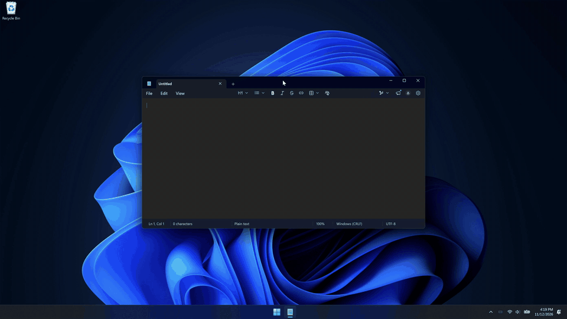
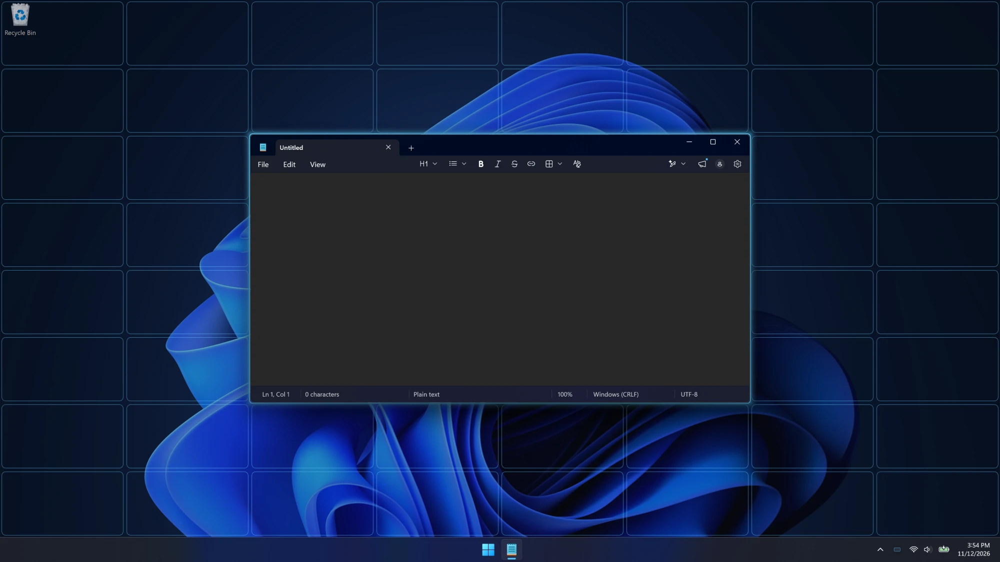
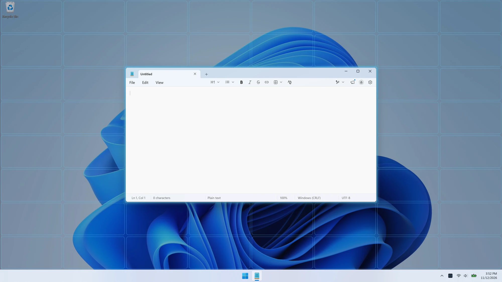

# Grid

A lightweight window manager for Windows. Drag a window, press a key, and snap it to a grid of
cells on your screen: one cell, or any rectangle of cells, even across monitors.



<details>
<summary>More screenshots: the overlay in dark and light mode</summary>





</details>

## Features

- **Resize**: while dragging a window, hold Space (or the right mouse button) to pick the first
  cell, release, then move to the last cell. The window covers everything in between.
- **Move**: press Left Ctrl (or the middle mouse button) and the window snaps to whole cells and
  moves a cell at a time, keeping its size.
- **Cancel** with Esc: the window goes back to where it was.
- Any grid size, a different grid per monitor, and grids that turn with portrait monitors.
- Multiple monitors, including monitors with different display scaling.
- Gaps between snapped windows and at the screen edges.
- Undo the last snaps, and save and restore all your window positions (with optional hotkeys).
- All inputs can be changed, including extra mouse buttons.
- A frosted-glass look: the overlay (with your own colors and opacity), Settings and the tray
  menu, in light and dark mode following Windows.
- Small and light: one ~11 MB `grid.exe` with nothing else to install, using about 10 MB of
  memory while running (as Task Manager shows it).
- Install it (for everyone or just you) or run it portably from any folder.
- Starts with Windows if you like: for you, for everyone on the PC, or as administrator, so it
  can also move windows of apps run as administrator (such as Task Manager) without asking.
- Checks GitHub for new versions and updates itself. Updates are signed, and Grid only installs
  ones signed with its author's key.

## Download and install

1. Download `grid.exe` from the [latest release](https://github.com/matthewmgraf/Grid/releases/latest).
2. Run it. Choose **Install for all users** (recommended), **Install just for me**, or **Run
   without installing** (portable: everything stays in its folder, but it can't start with
   Windows). Below the choices, pick how Grid starts with Windows; you can change it later in
   Settings → General.
3. Grid lives in the notification area (tray). Right-click its icon for Settings, updates and Exit.

Grid isn't code-signed yet, so Windows SmartScreen may warn about it the first time. Choose
"More info", then "Run anyway".

To uninstall, use Windows Settings → Apps → Installed apps → Grid, or Grid's Settings → General.

## Build from source

Requires Rust (stable, MSVC toolchain) and the Visual Studio C++ Build Tools.

```
cargo build --release
```

The program is written to `target/release/grid.exe`. `cargo test` runs the tests.

Builds only install updates signed with the key whose public half is in
`crates/grid-windows/release-key.hex`. To publish your own builds as updates, put your own key's
public half there (P-256, X then Y, 128 hex digits). Each release then needs `grid.exe.sig`: an
ECDSA P-256 / SHA-256 signature (R then S, 64 bytes) of `Grid release <version>`, a newline, and
then `grid.exe` (see `grid_core::update::signed_data`).

## License

Grid is free software under the [GNU General Public License v3.0 or later](LICENSE).
If Grid is useful to you, you can support it through [GitHub Sponsors](https://github.com/sponsors/matthewmgraf).

Grid is a new program written from scratch, inspired by WindowGrid by Joshua Wilding. It isn't
affiliated with WindowGrid and uses none of its code or artwork.
